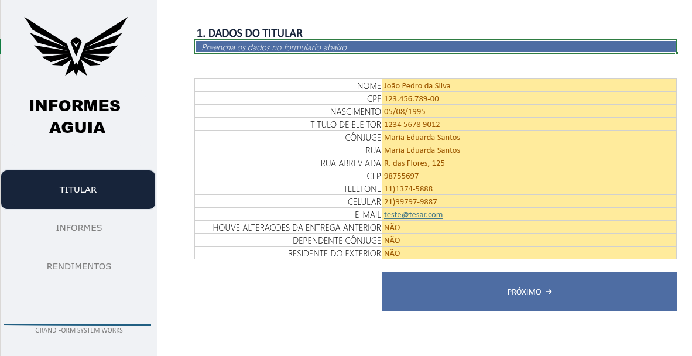
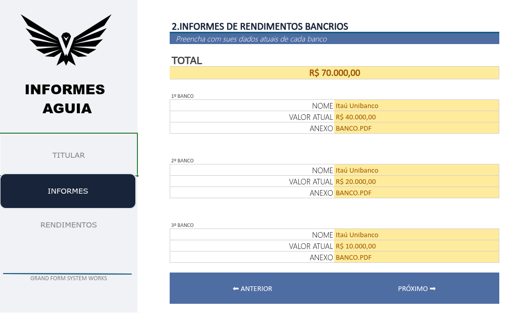
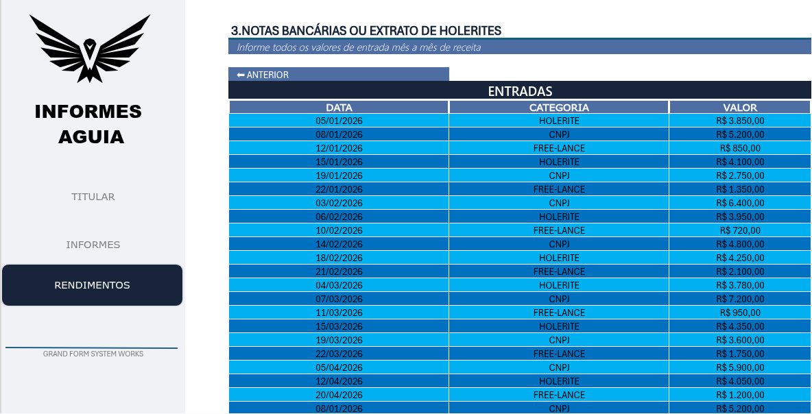

# dio-desafio-ferramenta-imposto-de-renda
https://1drv.ms/x/c/676839bb4896cf96/IQCk0VmH1M5CQ6YS-_-A6PjaAYRmlKWX_tpn9tzYKM_9jcE?e=JmJSxB

# Ferramenta de Organização para Imposto de Renda

## 📌 Sobre o Projeto

Este projeto foi desenvolvido como parte de um desafio da [Digital Innovation One (DIO)](https://www.dio.me/), com o objetivo de construir uma ferramenta no Microsoft Excel para auxiliar na organização e no gerenciamento de informações necessárias para a declaração do Imposto de Renda.

A proposta consiste em reunir dados importantes em uma única planilha, facilitando o preenchimento, a consulta e a organização das informações.

## 🎯 Objetivos

- Aplicar os conhecimentos adquiridos durante as aulas.
- Desenvolver uma ferramenta funcional utilizando o Microsoft Excel.
- Organizar informações relevantes para a declaração do Imposto de Renda.
- Implementar recursos de navegação e validação de dados.
- Documentar o desenvolvimento do projeto utilizando Markdown e GitHub.

## ⚙️ Funcionalidades

A ferramenta conta com:

- Organização centralizada das informações.
- Menus de navegação para facilitar o acesso às diferentes seções.
- Validações automáticas para auxiliar no preenchimento dos dados.
- Links rápidos para facilitar a navegação e o acesso a recursos.
- Interface organizada para melhorar a experiência de utilização.

## 🛠️ Tecnologias e Ferramentas

- Microsoft Excel
- GitHub
- Markdown

## 📂 Estrutura do Repositório

```text
dio-desafio-ferramenta-imposto-de-renda/
│
├── README.md
├── projeto.xlsx
└── images/
```

## 📸 Demonstração

Abaixo estão algumas capturas de tela da ferramenta desenvolvida:

### Dados do Titular


### Informes


### Rendimentos


## 📚 Aprendizados

Durante o desenvolvimento, foram aplicados conceitos de organização de dados, validação de informações, navegação entre planilhas e estruturação de ferramentas no Excel.

O projeto também proporcionou a prática de documentação técnica e utilização do GitHub para versionamento e compartilhamento de projetos.
